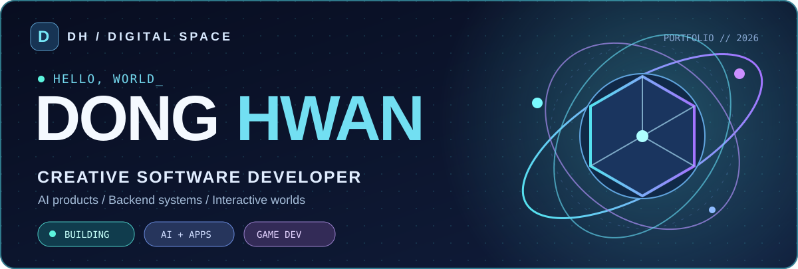
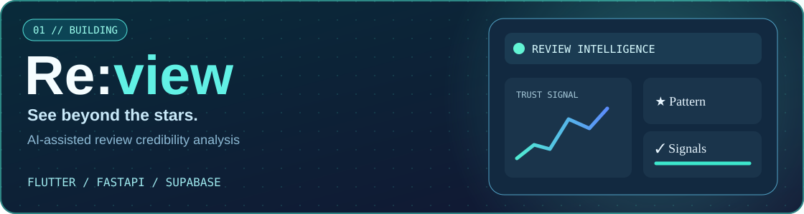
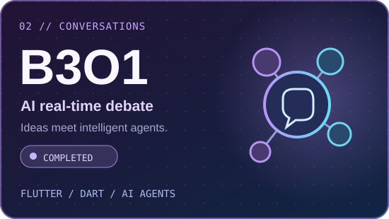
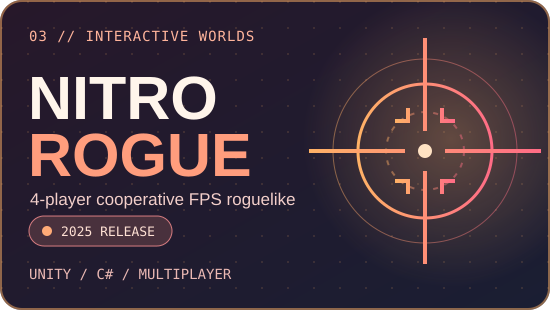
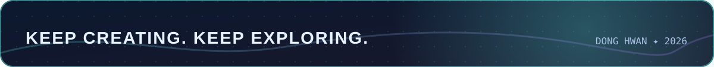

✦ Build ideas. Connect people. Create experiences.
AI-powered applications · Full-stack development · Interactive worlds

01 / About me
안녕하세요! 다양한 아이디어를 실제 서비스와 인터랙티브 경험으로 구현하는 개발자 Dong Hwan입니다.
모바일 애플리케이션, AI 기반 데이터 분석, 백엔드 시스템, 멀티플레이어 게임 개발을 탐구하고 있습니다.
- 🔭 Currently building: Re:view — 신뢰할 수 있는 쇼핑 리뷰 경험
- 🧠 Interested in: Applied AI · Product Engineering · Backend Infrastructure
- 🎮 Also creating: Cooperative games and interactive experiences
02 / Technology orbit

Applications & Backend

Data · Infrastructure · Creative

Technologies explored and used across projects; icons do not represent proficiency rankings.
03 / Featured missions

<table>
<tr>
<td width="50%" valign="top"></td>
<td width="50%" valign="top"></td>
</tr>
<tr>
<td valign="top">

B3O1 · 2026
AI 기반 실시간 토론 플랫폼 · Flutter / Dart / AI agents
Completed · Source repository link not verified
</td>
<td valign="top">

NITRO ROGUE · 2025
4인 협동 FPS 로그라이크 · Unity / C# / Multiplayer
Released project · Repository
</td>
</tr>
</table>

Re:view · In progress — Flutter / FastAPI / Supabase를 활용한 쇼핑 리뷰 신뢰도 분석 프로젝트.
Public source repository not verified; the banner links to my repository list.
04 / GitHub signal

Activity widgets are provided by third parties and may occasionally fail or rate-limit.

05 / Stay curious

Explore repositories →

